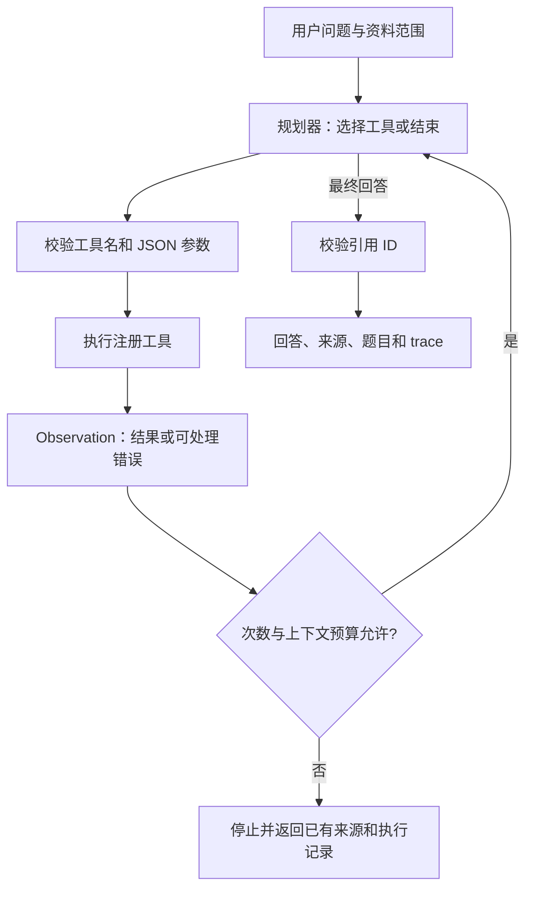

# Phase 2：试卷与学习 Agent

## 从哪里开始读

| 顺序 | 文件 / 函数 | 解决的问题 |
|---|---|---|
| 1 | `app/models/__init__.py` | 试卷、题目、知识点如何保存 |
| 2 | `app/services/exam_parser.py` | 原始文本、题号、跨页位置怎样对应 |
| 3 | `app/llm/exam_provider.py` | API 模式如何把原文抽成结构化题目 |
| 4 | `app/services/exams.py::_extract` | 如何拒绝伪造文本、原子替换题库和保存多对多关系 |
| 5 | `app/agent/tools.py::ToolRegistry` | 工具说明、Schema、参数验证与范围控制 |
| 6 | `app/agent/planner.py` | 模型如何选择工具；离线规则如何替代模型演示 |
| 7 | `app/agent/agent.py::StudyAgent.run` | Tool Calling、Observation、下一轮调用、停止条件 |
| 8 | `tests/test_phase2_api.py` | 用可控的模型响应验证完整链路 |

关键代码旁已经加入中文注释。注释主要解释为什么要做范围校验、来源编号、事务替换和循环限制，避免每行代码都重复解释语法。

## 一次任务的数据流



例如“解释 2025 期末第 12 题”：先 `search_questions` 找出真实 ID，随后 `get_question` 读取题干，再 `analyze_question` 检索课程教材、生成参考解析并查找相关题。API 模式不强制套用固定三步模板，模型可以在获得足够信息后选择下一步；同一题号有多个候选时应先明确具体题目。demo 使用固定规则展示这条链路，不称为模型自主规划。

## 模块 1：试卷结构化与来源

问题：普通 RAG 片段可能在一道题的中间切开，无法可靠按“某套卷子的第 12 题”查询。试卷解析直接读取原始解析块，不用重叠 RAG Chunk 重建题目。

新增四张表：

- `ExamPaper` 与一个原始 Document 关联，保存独立解析状态。
- `Question` 保存题号、题型、题干、选项、分值、难度和真实位置列表。
- `KnowledgePoint` 在课程内去重知识点名称。
- `QuestionKnowledgePoint` 保存题目与知识点的多对多关系。

`number` 用字符串保存，不作唯一键。第一大题第 1 题和第二大题第 1 题可以共存；前端和工具用 `question_id` 区分。`ordinal` 记录原卷顺序。

演示解析按数字题号和题型标题切题。API 解析给模型发送有长度上限的原文窗口，优先在题号边界分批，否则保留窗口重叠。模型返回 JSON，Pydantic 验证字段；`locate_quote` 进一步要求题干与选项匹配连续原文，只容忍空白排版差异。模型不能提交页码，后端根据原文字符范围恢复页码、幻灯片、段落位置。

先完成所有模型抽取和校验，再在一个 SQL 事务中删除旧题并写入新题。关联表使用外键级联删除旧关系。失败时回滚，保留旧数据但把试卷标为 failed；查询只返回 ready 试卷，避免把未完成的重解析结果当成新题库。

选择关系数据库是因为“按课程、试卷、题号、知识点筛选”是清楚的关系查询。替代方案包括全文索引、独立题目向量库或图数据库；当前数据量下 SQLite 容易运行和解释。短板是复杂版式、子题、公式和同义知识点仍可能处理不好，不能把结构化验证当作抽取完整率保证。

面试可回答：

1. 为什么不用 RAG Chunk 直接当 Question？Chunk 是检索单位，Question 是业务实体；两者边界和字段不同。
2. 为什么不让 LLM 生成页码？页码是文件事实，必须从解析位置映射，模型只负责识别题目。
3. 为什么要有独立试卷状态？题目抽取失败时，已成功的原文 RAG 仍然可用，重试也无需重新向量化。
4. `create_all` 是不是数据库迁移？当前只新增表，能兼容旧库；未来修改旧列结构时需引入显式迁移。

## 模块 2：工具注册与参数校验

注册五个工具：

| 工具 | 主要输入 | 输出 |
|---|---|---|
| `search_knowledge` | query | 教材、课件、笔记的引用片段 |
| `locate_source` | query | 带真实位置的引用片段 |
| `search_questions` | query、paper_name / paper_id、number、question_type、knowledge_point、limit | 候选题目及原卷证据 |
| `get_question` | question_id | 完整题目信息与原卷位置 |
| `analyze_question` | question_id | 参考答案、详细解析、资料证据、相关题 |

模型只看工具名、说明和 JSON Schema，输出工具调用请求；Python 后端才真正执行函数。Pydantic 同时生成 Schema 和验证运行参数，`extra="forbid"` 拒绝多余字段。白名单防止模型调用任意 Python 函数，不能使用 `eval` 执行模型文本。

课程 ID、用户所选资料范围由后端 `ToolContext` 注入，不作为模型可修改的工具参数。即使模型提供其他课程的题目 ID，查询也会重新核验归属。这是业务边界，不依赖提示词保证。

资料检索与试题检索分开：`search_knowledge` 排除试卷，避免拿“题干中的待求条件”当作参考答案的教学证据。题库目前用关键词与知识点关联；语义同义表达召回是后续增强项。

替代方案是 LangChain / LangGraph 等框架的工具与状态抽象。当前显式注册表更便于理解每一步，代价是错误恢复、状态和上下文预算要自己写。后续有分支并发、暂停恢复或人工审批需求时，再评估引入框架。

面试可回答：工具选择主要由模型根据工具 description 和用户请求决定；参数结构由 Schema 约束；后端仍须校验，因为兼容服务不一定严格执行 Schema。Planning 在这里体现为多轮选择动作，没有单独生成一份不可变的计划。

## 模块 3：Agent Loop

`StudyAgent.run` 是核心。每轮调用规划模型：

1. 收到 `tool_calls`：验证总预算，保存 assistant 调用消息。
2. 逐个执行工具，将结果以 `role="tool"`、对应 `tool_call_id` 写回消息列表。
3. 模型读取这些 Observation，决定改写检索、查题、分析或结束。
4. 收到最终 JSON：校验引用，输出来源卡片及执行轨迹。

工具异常转成 `{error: {code, message}}`，模型可在下一轮修正参数。超时或规划模型响应结构损坏时，返回受控停止状态，保留已执行轨迹。相同工具加相同参数的成功结果在本次请求内缓存，避免再次检索或分析；缓存命中仍计入调用预算。

`AGENT_MAX_STEPS` 限制工具总调用数（默认 6），规划最多调用上限加 1 次，最后一次留给生成终答。即使一轮返回多个工具也不能突破上限。`AGENT_CONTEXT_CHARS` 在每次模型请求前检查序列化消息大小；超限就停止，而不是悄悄丢掉来源。字符预算不是精确 Token 数，实际模型限制更小时需调低配置。HTTP 超时属于单次调用限制，不是整个任务的硬性超时。

所有检索工具共享一个来源注册表，以 chunk / question ID 去重并分配 S1、S2……。最终回答里的引用集合必须和声明集合一致，且来自实际工具结果。该检查能阻止不存在的引用，但不能自动证明每句话都被原文支持，因此仍需人工 QA。

trace 记录动作、参数、结果数量、错误、耗时，不记录隐藏思维过程。服务日志只记录工具名、状态和摘要，避免输出密钥与全文资料。消息列表仅在本次请求内存在，是任务工作记忆；尚未实现跨会话长期记忆。

面试可回答：

- 普通 RAG 是固定的“检索后回答”；Agent 可以根据观察选择和组合多种工具。
- Function Calling / Tool Calling 是模型输出结构化调用协议，实际函数由应用执行。
- ReAct 是交替推理、行动和观察的思路；本项目显式实现行动与观察循环，不向用户暴露隐藏推理。
- 死循环可能来自空结果、错误重复或模型不断要求相同动作；调用计数、上下文预算和请求内缓存共同限制影响。
- 工具失败不应直接终止整个服务；可修复错误回传给模型，达到预算后返回可解释的停止结果。

## 模块 4：题目解析与答案分析

抽题和解题分开。抽题只保存原卷内容；`analyze_question` 才检索相关教材，调用已有 LLM Provider 生成“参考答案、详细解析、涉及知识点”，并校验来源。资料不足时拒绝生成答案。相关试题通过已保存的知识点关联检索，限定同一课程与用户资料范围。

优点是题库可重复使用，模型分析不污染原题，答案和教师官方答案有明确区分。单题分析超过 6000 字符时提示拆分，不会静默截掉题目条件。限制是当前没有官方答案库、人工校订界面、公式计算工具或自动事实核验，难度标签只是模型估计。

## 运行和验收

```powershell
.\.venv\Scripts\python.exe -m scripts.make_fixtures
.\.venv\Scripts\python.exe -m scripts.make_exam_fixtures
.\.venv\Scripts\python.exe -m uvicorn app.main:create_app --factory --host 127.0.0.1 --port 8000
```

网页先上传教材，再按「试卷」上传示例卷。用 Agent 提问“解释 2025 期末第 12 题”，展开工具过程；用题库查看题干、类型、分值、知识点与来源。已有 Phase 1 试卷不会启动时自动调用模型，需要点击解析按钮。

```powershell
.\.venv\Scripts\python.exe -m pytest -q
.\.venv\Scripts\python.exe -m ruff check .
node --check app/static/app.js
.\.venv\Scripts\python.exe -m scripts.evaluate_agent --output data/evaluation-agent-demo.json
```

可选浏览器脚本 `scripts/browser_phase2.cjs` 使用已有 Playwright 与 Edge，设置 `PLAYWRIGHT_MODULE` 可指定包路径，`STUDY_URL` 可指定服务地址。Playwright 不是后端新增依赖。验收涵盖上传、题库、三步 Agent 链、单题分析、来源展示和手机布局。

2026-09-21 本机验收：41 项测试通过，Ruff 和 JavaScript 语法检查通过；Edge 浏览器上述流程通过，无 JavaScript 错误和 390px 宽度横向溢出。测试保留两条上游依赖弃用警告。

真实 API 验收先配置 `.env`，选择支持工具调用的模型并重启，再重解析试卷。`python -m scripts.evaluate_agent --mode api` 会发送原创样本并产生 API 用量；它不能替代人工检查题干是否完整、知识点是否合理、答案是否正确。真实服务尚未在本次开发中调用，不能声称真实模型质量已通过。

协议参考：[OpenAI 官方 Function Calling 文档](https://developers.openai.com/api/docs/guides/function-calling)。本项目沿用兼容 Chat Completions 的工具调用格式；具体服务是否支持需按实际配置验收。

## 可以写进简历的内容

完成真实课程和模型评测前，可以描述已实现的工程能力：基于 FastAPI、SQLite 与 Chroma 实现多源课程 RAG；实现带来源校验的试题抽取及知识点多对多关联；以显式工具注册与有界执行循环实现查题、定位及参考解析，支持执行轨迹、错误观察和引用校验。

离线报告中是 12 条原创小样本的规则路由命中 12/12，不能表述为“LLM 工具调用准确率 100%”。真实模型的准确率、节省成本或召回提升必须等实测后再写。
