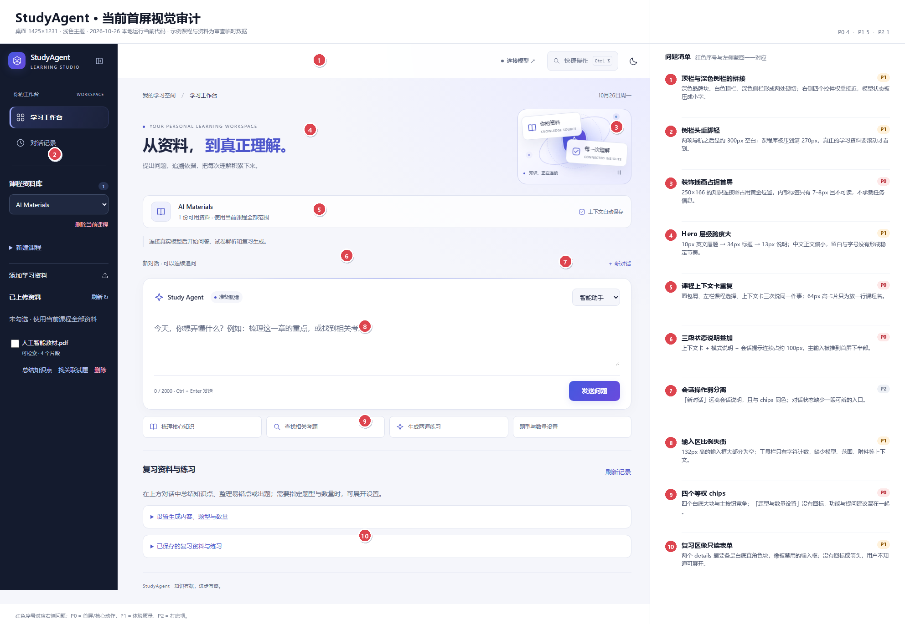
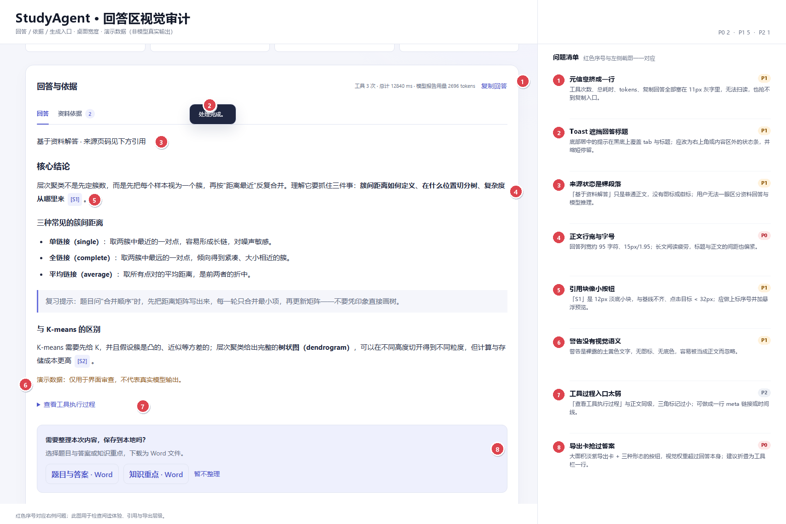
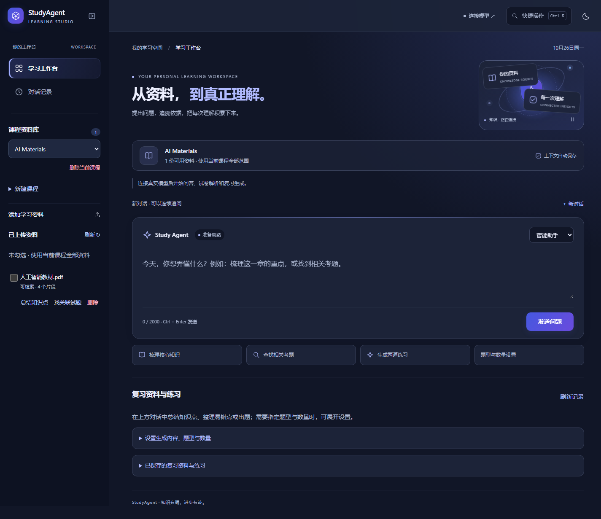
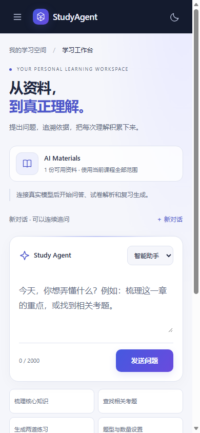
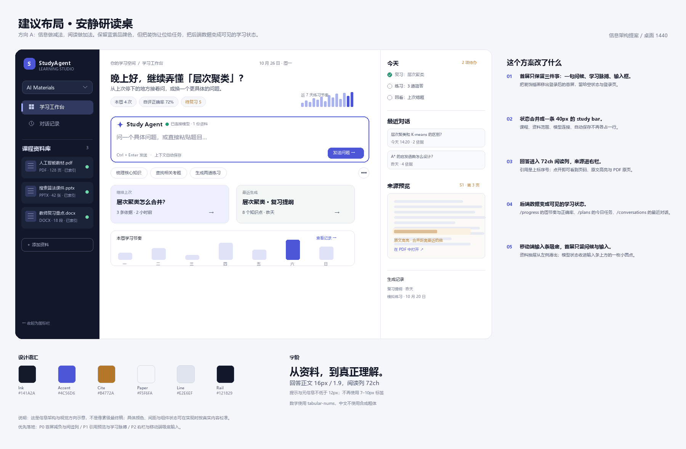

# StudyAgent 界面美化建议（结合后端）

> 审查对象：当前仓库 `app/static` 的前端与 `app/api`、`app/services` 中可直接支撑界面的数据。
> 审查方式：本地启动当前代码，截取桌面 / 移动 / 深色首屏，并用演示数据渲染回答区；没有修改任何应用代码。
> 截图日期：2026-10-26。

---

## 0. 先说结论

当前界面**不是“不精致”**。它已经有清晰的品牌方向（深靛侧栏 + 蓝紫主色）、完整的浅深主题、键盘与读屏支持、真实的 SSE 执行状态，以及一套知识连接的视觉隐喻。真正的问题是：

1. **首屏把“展示”放在了“任务”前面**：34px Hero、装饰插画、三段状态说明、四个等权 chip，把最重要的输入框推到了首屏下半部。
2. **视觉语汇没有收敛**：四层 CSS 叠加、`--green` 里存的是靛蓝、同一页面出现 4 套字号和圆角，导致“每个局部都还行，整体不统一”。
3. **后端数据被浪费**：`/progress` 的周节奏与正确率、`/conversations` 的对话元信息、PDF 原页渲染能力、`/artifacts` 的生成结果，都还没有变成界面语言。

建议方向不是推倒重来，而是做一次 **“安静研读桌（Quiet Study Desk）”** 的收敛：

- 首屏只保留三件事：**一句问候、学习脉搏、输入框**。
- 回答区变成真正的阅读界面：**72ch 阅读列 + 上标引用 + 右侧来源预览**。
- 装饰插画只在空状态 / 登录页出现；登录后的位置让给**真实的学习数据**（资料、薄弱点、今日任务、最近对话）。
- 先做纯前端快赢（1–2 天），再用后端把“好看”升级成“有用”（3–5 天）。

### 如果只看 5 条

| 改动 | 影响 | 成本 | 优先级 |
|---|---|---|---|
| 登录后首屏去掉装饰插画，合并三段状态说明 | 首屏主任务立刻清晰 | 低 | P0 |
| 回答列收到 72ch，引用改上标 | 长文可读性明显提升 | 低 | P0 |
| 统一 token 与字号下限 | 全站观感从“拼装”变“一套” | 中 | P0 |
| 用 `/progress` 做一条学习脉搏 | 首屏有“我的学习”而不是“产品介绍” | 低 | P1 |
| 引用侧栏 + PDF 原页预览 | “有来源”变成看得见的证据 | 中 | P1 |

**不建议做**：再加一层装饰动画、引入远程字体、把所有卡片都做成玻璃拟态、为了“干净”隐藏模型/资料状态。这个产品的差异化是“有依据”，视觉应该服务这个信任感，而不是更像一个通用 AI 聊天壳。

---

## 1. 现状评估

### 1.1 已经做得好的地方（建议保留）

- **语义与可访问性**：`header / nav / main / section / dialog` 结构清楚；skip link、`aria-current`、`aria-live`、焦点可见、44px 点击区域、`prefers-reduced-motion` 都处理过。
- **真实的执行反馈**：`/api/agent/stream` 用 SSE 推送 status / tool 事件，界面不是假进度条；回答只在来源校验后渲染。
- **主题与响应式**：浅色 / 深色、桌面收起导航、手机资料抽屉、320px 宽度都有考虑。
- **无远程字体与图片依赖**：图标是 SVG sprite，插画是 CSS/SVG 构建，加载稳定。
- **空状态与错误状态**：不是只有成功路径，失败、处理中、取消、删除都有对应文案。

这些是很多同类项目没有的底子。下面的建议是在这个底子上做**减法与收束**，不是换一套花哨皮肤。

### 1.2 主要问题

**A. 信息架构：一屏有太多“入口”**

登录后的首屏从下往上数，出现了：

- 面包屑「我的学习空间 / 学习工作台」
- Hero 眉题 + 34px 标题 + 副文案
- 知识连接插画（166px 高）
- 课程上下文卡（64px）
- 模式说明（24px）
- 会话说明 + 新对话（24px）
- 输入框（132px）
- 四个 prompt chip
- 复习资料与练习（两个 details）

真正要做的只有一件事：**提问**。其余信息应该合并、后置或移除。

**B. 视觉语汇：四层 CSS 互相覆盖**

`index.html` 同时加载：

```text
style.css → minimal.css → workspace.css → professional.css
```

四份文件分别定义了 `:root` 色板与字号；`workspace.css` 里 `--green: #4d56cb`，变量名与颜色语义已经脱节。结果：

- 同一个输入框的高度在四份文件里被写成 132 / 140 / 100 / 104px；
- Hero 标题在 30 / 34 / 36 / 43px 之间来回覆盖；
- 同一类卡片有 12 / 13 / 14 / 16 / 18 / 20px 多种圆角；
- `interactions.js` 与 `vibrant.css` 已不在页面中加载，但仍留在仓库里（前者还会引用不存在的 `#palette-menu`、`#hero-greeting`）。

这不是“审美问题”，而是**无法稳定演进的结构问题**。建议先收敛 token，再做视觉。

**C. 阅读体验：回答列太宽、引用太弱**

- 回答列宽约 1,100px，15px 正文，一行接近 95 个字符；中文长回答很难保持视线。
- 引用 `[S1]` 是 12px 淡底小块，与正文基线不齐，点击目标小于 32px。
- 来源卡片的“打开原文”只打开文件，不带页码；PDF 明明支持 `#page=`，但没有用上。
- 回答完成后没有自动滚动或焦点转移，用户可能只看到“处理完成”的 toast，回答在首屏下方。

### 1.3 关键代码位置

- 页面结构与样式入口：[index.html](../../app/static/index.html#L8-L16)；Hero / 输入框 / chips 分别在 [L95](../../app/static/index.html#L95)、[L104](../../app/static/index.html#L104)、[L106](../../app/static/index.html#L106)；统计条在 [L107](../../app/static/index.html#L107) 被 `hidden`。
- 四层样式：[minimal.css](../../app/static/minimal.css#L1-L24)、[workspace.css](../../app/static/workspace.css#L1-L41)、[professional.css](../../app/static/professional.css#L1-L40)；[style.css](../../app/static/style.css#L2) 里还保留最早的一套绿色 token。
- 学习进度数据：[learning API](../../app/api/learning.py#L9-L13) → [progress 实现](../../app/services/learning.py#L162-L228)。
- Agent SSE：[agent.py](../../app/api/agent.py#L45-L96)；前端消费在 [app.js](../../app/static/app.js#L1191-L1248)。
- PDF 页渲染：[pdf_visuals.py](../../app/services/pdf_visuals.py#L17-L100)。
- 资料列表：[documents.py](../../app/api/documents.py#L69-L80)；生成物摘要：[generation.py](../../app/schemas/generation.py#L95-L111)。
- 历史对话：[learning.py](../../app/services/learning.py#L343-L355)（当前只返回 `id / question / kind / created_at`）。

### 1.4 后端数据没有变成界面

| 已有能力 | 现在界面 | 可以变成 |
|---|---|---|
| `/progress` 周练习、正确率、薄弱点、计划完成 | 统计条被隐藏 | 40px 学习脉搏 + 7 天 sparkline |
| `/conversations` 历史问答 | 只有问题 + 时间 | 来源数、回答摘要、按天分组 |
| `/artifacts` 生成结果 | 两个 details 列表 | 带类型/题量/知识点数的结果卡 |
| `PDFVisuals` 已能渲染指定页 | 仅发给模型 | 引用侧栏的 PDF 原页缩略图 + 高亮 |
| SSE status / tool 事件 | 3 个小圆点标签 | Agent 执行时间线 |
| `/knowledge-points`、`weak_topics` | 未使用 | 真实的知识地图（替代装饰插画） |

---

## 2. 视觉审计图

### 2.1 首屏



| # | 问题 | 影响 | 优先级 | 建议改法 |
|---|---|---|---|---|
| 1 | 深色品牌块 / 白色顶栏 / 深色侧栏两处硬切 | 顶部显得碎，状态控件拥挤 | P1 | 把顶栏并入 rail 体系，或统一为浅色玻璃顶栏；右侧只留状态 + 搜索 + 主题 + 头像 |
| 2 | 两项导航后约 300px 空白 | 课程库被压到第 270px，资料要滚动才看到 | P1 | 课程切换上移到导航下方；资料库做成可滚动区；空白处放“今日/最近” |
| 3 | 装饰插画占 250×166 | 抢占黄金位置，内部 7–8px 标签不可读 | P0 | 登录后隐藏，仅保留在空状态 / 登录页；登录后该位置放学习脉搏 |
| 4 | Hero 字号跨度大 | 10px 眉题 → 34px 标题 → 13px 说明 | P1 | 登录后改成 24–28px 问候；眉题合并到问候上方一行，不再用 7–10px |
| 5 | 课程上下文卡重复 | 面包屑、左栏选择器、卡片三次说同一件事 | P0 | 合并成一条 40px `study bar`：课程 / 范围 / 模型 / 自动保存 |
| 6 | 三段状态说明叠加 | 输入框被推到首屏下半部 | P0 | 模式说明改为状态点；会话说明并入 study bar |
| 7 | 新对话与上下文分离 | 操作入口弱，和 chip 同色 | P2 | 放到 study bar 右侧，做成 ghost 按钮 |
| 8 | 输入框 132px 高、工具栏空 | 空白多，缺少模型/范围/附件上下文 | P1 | 96–120px 自适应高度；底部左侧放范围与附件，右侧发送 |
| 9 | 四个等权 chips | 与主按钮竞争；设置混在建议里 | P0 | 3 个文字 pill + 一个齿轮图标；设置收进 composer 工具条 |
| 10 | 复习区 details 像输入框 | 白底直角色块，缺少展开 affordance | P1 | 统一 details 组件：图标 + 标题 + 右侧 chevron，背景透明、1px 分隔 |

### 2.2 回答区



| # | 问题 | 影响 | 优先级 | 建议改法 |
|---|---|---|---|---|
| 1 | 工具 / 耗时 / token / 复制挤成 11px 一行 | 无法扫读，复制入口弱 | P1 | 拆成 meta chips；复制改为图标按钮 + tooltip |
| 2 | Toast 覆盖回答标题 / tabs | 遮挡内容，打断阅读 | P1 | 移到右上角或内容区外；3 秒自动消失；不覆盖操作区 |
| 3 | “基于资料解答”是裸段落 | 分不清资料回答与模型推理 | P1 | 做成来源徽标：`资料回答 · 2 条引用`，可点开来源 |
| 4 | 行宽约 95 字符、15px | 长文阅读疲劳 | P0 | 阅读列 72ch、正文 16px/1.9、标题 20/18px |
| 5 | 引用块像小按钮 | 基线不齐、点击目标小 | P1 | 上标序号 + hover 预览 + 侧栏定位 |
| 6 | 警告是裸土黄色文字 | 容易被当成正文忽略 | P1 | 带图标的 warning banner（浅琥珀底 + 左侧 3px 边） |
| 7 | 工具过程入口弱 | 用户不知道可以展开 | P2 | 一行 `执行过程 · 3 步` + chevron，或时间线 |
| 8 | 导出卡抢过答案 | 大面积淡紫 + 三种按钮形态 | P0 | 折叠为结果工具栏的一行；Word / Markdown 收进菜单 |

### 2.3 深色与移动端



深色主题的主要问题不是“不好看”，而是**层级被压平**：rail、背景、卡片都接近同一明度，内容区缺少 elevation 阶梯。建议把暗色表面分成 3 级（`bg #0F1320` → `surface #171C2B` → `sunken #1F2637`），并让 accent 只出现在可操作元素上。



移动端首屏到 844px 底部只看到 chips 的上沿；Hero、上下文卡、状态说明占了约 420px。建议移动端：

- 首屏只留问候 + 一行学习脉搏 + 输入框；
- 输入条吸底，展开后全屏编辑；
- 资料抽屉从左滑出，模型状态收进输入条上方的小圆点；
- 不隐藏“发送”，不让用户滚动后才看到主操作。

---

## 3. 建议方向：安静研读桌



### 3.1 三区布局

| 区域 | 宽度 | 内容 |
|---|---|---|
| 左侧 rail | 220px（可收 72px） | 品牌、课程切换、两个导航、课程资料库、添加资料 |
| 主阅读列 | 约 720–760px | 问候、学习脉搏、输入框、建议、继续上次、回答与来源 |
| 右侧上下文 | 280–320px（≥1280px） | 今天、最近对话、来源预览、生成记录 |

窄屏顺序：≥1280 三栏；980–1280 收起右栏为抽屉；<980 rail 收成图标；<700 单栏 + 吸底输入条。

### 3.2 首屏只做三件事

**改造前 → 改造后**

| 现在 | 建议 |
|---|---|
| 34px Hero + 166px 插画 | 24–28px 问候 + 一行副文案；插画只在空状态 / 登录页 |
| 上下文卡 + 模式说明 + 会话说明 | 一条 40px study bar：`AI Materials · 1 份资料 · 已连接 · 自动保存` |
| 四个等权 chip | 3 个文字 pill + 齿轮；设置放进 composer 工具条 |
| 统计条被隐藏 | 40px 学习脉搏：`本周 4 次 · 正确率 72% · 待复习 5` + sparkline |
| 132px 空输入框 | 96–120px 自适应；底部左范围、右发送 |
| 复习区两个 details | 一张“继续上次” + 一张“最近生成”卡；全部记录收进下方 |

这样首屏高度可以从约 1,000px 降到 700px 左右，1366×768 的笔记本也能在首屏看到输入框和发送按钮。

### 3.3 回答进入“阅读模式”

第一次回答完成后，建议做一次视图切换：

- 收起 Hero 与 study bar，只留一条 40px 的会话条（课程、范围、新对话）；
- 回答从 72ch 列开始，来源进入右侧抽屉；
- 输入框变为吸底 / 折叠的“继续追问”；
- 顶部提供“回到资料库”和“新对话”。

这比在首屏下面不断追加卡片更像一个学习产品，也能自然承载多轮对话。

---

## 4. P0：纯前端快赢（1–2 天）

### 4.1 先统一 token，而不是继续加覆盖

建议新建一个 `tokens.css`，让颜色、字号、圆角只有一个来源；四份旧文件暂时保留，但只允许引用变量，不再各自定义。

```css
:root {
  /* 表面与文字 */
  --bg: #f5f6fa;
  --surface: #ffffff;
  --sunken: #eef1f7;
  --ink: #141a2a;
  --ink-2: #475069;
  --muted: #6b7488;
  --line: #e2e6ef;

  /* 语义：蓝紫只表示“可操作”，琥珀只表示“依据”，绿/红只表示状态 */
  --accent: #4c56d6;
  --accent-strong: #3b45c4;
  --accent-weak: #eef0ff;
  --cite: #b4772a;
  --cite-weak: #fbf1e3;
  --ok: #1f7a5a;
  --warn: #a15c0b;
  --danger: #b3314d;

  /* rail */
  --rail: #121829;
  --rail-2: #1b2438;
  --rail-ink: #f0f3ff;
  --rail-muted: #aeb8d2;

  /* 形状 */
  --r-sm: 8px;
  --r-md: 12px;
  --r-lg: 16px;
  --r-xl: 20px;

  /* 阴影：只给浮层和聚焦态 */
  --shadow-overlay: 0 18px 50px #10182b1f;
}

:root[data-theme="dark"] {
  --bg: #0f1320;
  --surface: #171c2b;
  --sunken: #1f2637;
  --ink: #eef1fa;
  --ink-2: #c3cad9;
  --muted: #9aa4ba;
  --line: #2a3145;
  --accent: #a7b1ff;
  --accent-strong: #c0c8ff;
  --accent-weak: #232a4a;
  --cite: #e0b477;
  --cite-weak: #2e271d;
  --ok: #7fd3b2;
  --warn: #f0c27a;
  --danger: #ffb3c1;
  --rail: #0b0f1b;
  --rail-2: #141a2b;
}
```

**关键原则**：一个页面只有一个强色（主按钮），一个暖色（引用/依据），状态色只出现在状态元素上。现在的 `--green` 同时承担品牌、成功、链接、数字，视觉上就会“到处都是重点”。

### 4.2 字号与阅读

| 用途 | 现在 | 建议 |
|---|---|---|
| 页面标题 | 34–43px | 24–28px（登录后） |
| 区块标题 | 17–20px | 18px / 1.35 |
| 正文 | 12–15px | 14px / 1.7 |
| 回答正文 | 15px / 1.95 | 16px / 1.9，最大 72ch |
| 提示 / 元信息 | 9–11px | 不低于 12px |
| 英文眉题 | 7–10px | 11px，仅保留 1–2 处 |

```css
.answer {
  max-width: 72ch;
  font-size: 16px;
  line-height: 1.9;
}
.answer p { margin: 0 0 15px; }
.answer h2 { font-size: 20px; margin: 30px 0 12px; }
.answer h3 { font-size: 18px; margin: 24px 0 10px; }
```

中文不要用 7–10px 的英文式眉题来制造“设计感”；它会让页面显得更碎，而不是更高级。

### 4.3 首屏减负（改动最小、收益最大）

先做这两组样式，不动业务逻辑：

```css
/* 登录后不再展示装饰插画，把位置让给学习脉搏 */
body[data-auth="signed-in"] .knowledge-scene { display: none; }
body[data-auth="signed-in"] .studio-hero {
  grid-template-columns: 1fr;
  min-height: 0;
  padding: 4px 0 16px;
  margin-bottom: 18px;
}
body[data-auth="signed-in"] .hero h1 {
  font-size: clamp(24px, 2.4vw, 28px);
  line-height: 1.35;
}
body[data-auth="signed-in"] .hero .intro { margin-top: 8px; }
```

接着把三行状态合并成一行（HTML 结构可以最后再做，先用 CSS 收掉重复说明）：

```css
#mode-note { display: none; }          /* 信息进入 study bar 的状态点 */
.session-bar { margin-bottom: 8px; }
.workspace-context { padding: 10px 14px; }  /* 64px → 44px */
```

### 4.4 引用与来源：先做两个低成本的“正确”

**（1）打开原文时带页码（纯前端，1 行）**

`app/static/app.js` 的 `sourceCard()` 里：

```js
if (source.location_type === "pdf_page" && source.page) {
  link.href = `${source.file_url}#page=${source.page}`;
}
```

**（2）引用改成上标**

```css
.inline-citation {
  display: inline;
  min-height: 0;
  min-width: 0;
  padding: 0 3px;
  margin: 0 1px;
  font-size: 11px;
  font-weight: 600;
  line-height: 1;
  vertical-align: super;
  color: var(--cite);
  background: var(--cite-weak);
  border: 0;
  border-radius: 4px;
  box-shadow: none;
}
```

这样 `[S1]` 不再打断中文行高，也更像“依据”而不是“按钮”。

### 4.5 组件状态收束

建议只保留三种按钮：

| 类型 | 用途 | 样式 |
|---|---|---|
| Primary | 每个区域唯一主操作 | `background: var(--accent); color: #fff;` |
| Secondary | 并列操作 | `background: var(--surface); border: 1px solid var(--line);` |
| Ghost | 弱操作 / 文本链接 | 透明底，`color: var(--ink-2)` |

不要再让 `secondary` 同时承担白底、浅紫底、透明底三种外观；也不要每个卡片 hover 都上浮 2–3px。把动效预算留给：

- 发送成功后的结果出现（translateY 8px + opacity，220ms）；
- 引用定位时的高亮（背景 600ms 后淡出）；
- Agent 运行中的状态呼吸（单点，1.6s）。

### 4.6 Toast、滚动与重复卡片

- Toast：从底部居中改为**右上角**（`top: 88px; right: 24px`），避免遮挡 tabs 和回答标题；3 秒自动消失。
- 回答完成：`renderResult()` 末尾调用 `$("result").scrollIntoView({block: "start"})`，并把焦点放到结果标题（`tabindex="-1"`），而不是让用户自己找。
- 导出卡只保留一处：现在是“回答下方 + 生成预览里”各出现一次；建议统一为结果工具栏的一个“保存 / 导出”菜单。

### 4.7 清理 CSS 结构

建议分两步，不要一次重写：

1. **删除死文件与死引用**：`vibrant.css`、`interactions.js` 当前未被 `index.html` 加载；先删或归档，避免后续误改。
2. **加 cascade layers**，固定优先级：

```css
@layer tokens, base, layout, components, pages, utilities;
```

把现有四份文件的内容按层归位，最终只保留一个入口 `app.css`。短期也可以先用 `@import layer(...)` 包住旧文件，保证顺序不再靠“谁后加载”。

另外，`index.html` 里的 `?v=20261021-local-word` 是手工维护的；建议由 `/health` 返回 `build`，模板注入或运行时用 build hash 替换，避免“改了 CSS 但浏览器还在用旧的”。

---

## 5. P1：把后端数据变成界面（3–5 天）

### 5.1 学习脉搏：`/progress` 已经在返回，只差展示

**现状**：`GET /api/courses/{course_id}/progress` 返回 `week[7]`、`accuracy`、`active_wrong`、`plan_tasks`、`completed_tasks`、`weak_topics`；当前首屏把统计条隐藏了。

**建议**：在问候下面放一条 40px 的 pulse：

```text
本周 4 次   ·   自评正确率 72%   ·   待复习 5   ·   [7 天 sparkline]
```

点击后分别跳到对话记录 / 错题 / 计划。无需新接口。

```js
const progress = await api(`/api/courses/${courseId}/progress`);
renderPulse({
  week: progress.week,
  accuracy: progress.accuracy,
  weak: progress.active_wrong,
});
```

> 注意：正确率是**自评**结果，文案保留“自评”，不要做成看起来像自动评分的环形图。

### 5.2 引用侧栏 + PDF 原页预览（最高性价比的后端联动）

**现状**：`Source` 已经有 `document_id`、`page`、`file_url`；`app/services/pdf_visuals.py` 已经能用 `pypdfium2` 渲染指定页，但只用于发给模型。

**建议**：

1. 新增只读接口：

```text
GET /api/documents/{document_id}/pages/{page}?width=900
→ image/jpeg（磁盘缓存 + ETag）
```

复用 `PDFVisuals` 的渲染与 `pdfium_lock`，把结果缓存到 `data/preview-cache/{document_id}/{page}-{width}.jpg`。要校验课程 / 文档状态，禁止任意路径。

2. 回答区右侧打开“来源抽屉”：页面缩略图 + 原文高亮 + `第 3 页 / 共 128 页` + “在 PDF 中打开 ↗”。

3. 点击正文 `[S1]` 时，抽屉定位到对应来源并滚动高亮。

这项改动会让“有来源”从一句文案变成一个**看得见的证据界面**，也是这个产品最有辨识度的部分。

### 5.3 资料卡：从“文件名 + 片段数”到“可识别的资料”

**现状**：`DocumentOut` 只有 `name / file_type / document_type / status / chunk_count`。

**建议**：

- 前端先用 `file_type` 做 PDF / PPTX / DOCX 三色图标；
- 后端补 `page_count`（PDF 页数 / PPTX 张数）与 `processed_at`；`Document` 表目前没有这两列，可以用一次手写 `ALTER TABLE` 或先从 chunks 聚合 `max(page)`（对 DOCX 不适用）；
- 处理中显示阶段：`解析 → OCR → 切块 → 索引`，不要只显示“正在处理”；
- 选中资料时，整行左侧出现 2px accent 竖条，而不是只靠 checkbox。

资料库是用户每天都会看的地方，它比 Hero 更值得投入视觉预算。

### 5.4 Agent 时间线：SSE 已经在推送

**现状**：`/api/agent/stream` 推送 `status` 与 `tool`（`step / purpose / status`），前端渲染成 3 个小标签。

**建议**：把 loading 区改成纵向时间线：

```text
● 检索资料            412ms
│  命中 4 个片段 · 2 份资料
● 阅读原文            118ms
│  第 3、5 页
● 校验引用              9ms
│  2 条引用有效
○ 生成回答
```

- 进行中的步骤用一条呼吸的 accent 线；
- 完成后折叠为 `执行过程 · 3 步 · 12.8s`；
- 耗时可在前端用 `performance.now()` 计算，后端不必新增字段。

这比三个灰色标签更能建立“Agent 在工作”的信任感。

### 5.5 生成物：从 details 列表到结果卡

**现状**：`ArtifactSummary` 只有 `id / kind / title / mode / created_at / warning`；界面是两个 details 摘要条。

**建议**：

- API 增加派生字段：`section_count`、`question_count`、`topic_count`、`source_count`（从 `payload.content` 计算，不需要改表）；
- 界面用卡片网格：`复习提纲 · 8 个知识点 · 3 条依据` / `模拟练习 · 5 题 · 适中`；
- 卡片上直接提供“继续练习 / 预览 / 下载 Word”，而不是先展开 details；
- 当前“导出卡”在回答区和预览区重复出现，应在结果卡内只保留一份。

### 5.6 对话记录：按天分组，给出“继续追问”的入口

**现状**：`/conversations` 只返回 `id / question / kind / created_at`；界面是编号 + 问题 + 时间。

**建议**：

- 列表接口补 `source_count`、`answer_excerpt`、`answer_basis`（从 `payload` 派生，避免前端 N+1）；
- 前端按“今天 / 昨天 / 更早”分组，左侧时间线，右侧卡片；
- 卡片显示 2 行回答摘要 + 来源数 + “继续追问”；
- 这样历史页才像“思考的记录”，而不是一个带编号的列表。

### 5.7 把装饰插画换成真实知识地图

**现状**：Hero 右侧是一张固定的“你的资料 ↔ 每一次理解”装饰图。

**建议**：保留同样的视觉位置与动效语言，但让它由真实数据驱动：

- 节点 = 课程资料（大小按 `chunk_count`）；
- 连线 = 资料与知识点的关联（`/knowledge-points`、`/material-question-links`）；
- 颜色 = 掌握度（`/progress.weak_topics`：待复习用琥珀，已掌握用绿）；
- 点击节点 = 过滤资料范围 / 跳到相关对话。

这样它从“装饰”变成“导航 + 学习状态”。如果本期不做，至少先把装饰图移出登录后的首屏。

### 5.8 首次使用：用后端状态做 4 步引导

当前首屏有“连接模型后开始问答”“上传教材可补充依据”“登录后启用”等多条提示，但它们没有形成一个流程。

用 `/health`、`/api/connection`、`/api/courses`、`/documents` 的状态做一个 4 步卡片：

```text
① 连接模型  ✓
② 创建课程  ● 进行中
③ 上传资料  ○
④ 提一个问题 ○
```

只显示当前步骤 + 下一步按钮，其余步骤收起。它比三段散落的状态说明更友好，也更适合截图展示。

---

## 6. 设计系统建议

### 6.1 Token

| 类别 | 建议值 |
|---|---|
| 背景 | 浅 `#F5F6FA` / 深 `#0F1320` |
| 卡片 | 浅 `#FFFFFF` / 深 `#171C2B` |
| 下沉面 | `#EEF1F7` / `#1F2637` |
| 主文字 | `#141A2A` / `#EEF1FA` |
| 次文字 | `#475069` / `#C3CAD9` |
| 弱文字 | `#6B7488` / `#9AA4BA` |
| 分割线 | `#E2E6EF` / `#2A3145` |
| 主色 | `#4C56D6`（只给可操作） |
| 引用色 | `#B4772A`（只给依据/高亮） |
| 成功 / 警告 / 危险 | `#1F7A5A` / `#A15C0B` / `#B3314D` |
| rail | `#121829` / `#0B0F1B` |

### 6.2 字阶

| Token | 字号 / 行高 | 用途 |
|---|---|---|
| display | 28 / 36 | 登录后问候 |
| h1 | 24 / 32 | 页面标题 |
| h2 | 18 / 26 | 区块标题 |
| h3 | 15 / 22 | 卡片标题 |
| body | 14 / 22 | 普通正文 |
| reading | 16 / 30 | 回答正文 |
| meta | 12 / 18 | 元信息 |
| micro | 11 / 16 | 英文眉题（少量） |

字重只用 400 / 500 / 600；不要用 650 / 700 去模拟“更高级”。中文不要用 letter-spacing 制造紧凑感。

### 6.3 间距、圆角、阴影

- 间距：4 / 8 / 12 / 16 / 24 / 32 / 48；区块之间 32–40px。
- 圆角：8（小控件）/ 12（卡片）/ 16（大卡片、浮层）；只有 modal 用 20–24。
- 阴影：默认只用 1px 边框；hover 不位移；`--shadow-overlay` 只给 dialog / drawer / toast。
- 阅读容器：`max-width: 760px`；首屏主列 `max-width: 1120px`。

### 6.4 组件状态

| 组件 | 必须定义的状态 |
|---|---|
| Button | default / hover / active / disabled / focus-visible / loading |
| Input / Textarea | default / focus / error / disabled / read-only |
| Card | default / hover / selected / disabled |
| Tag | neutral / accent / cite / success / warning / danger |
| Details | closed / open / focus / disabled |
| Toast | info / success / warning / error |

当前 `button:disabled { cursor: wait }` 会让“不可用”和“正在处理”混在一起；建议 disabled 用 `not-allowed`，loading 单独一个状态。

---

## 7. 落地顺序与验收

| 阶段 | 时间 | 内容 | 涉及文件 | 风险 |
|---|---|---|---|---|
| P0 快赢 | 1–2 天 | token、字号、首屏减负、引用上标、toast、滚动、导出卡合并 | `minimal.css` / `workspace.css` / `professional.css` / `app.js` | 低 |
| P1 数据联动 | 3–5 天 | 学习脉搏、来源抽屉、资料元信息、Agent 时间线、生成物卡、对话分组 | `app.js`、`app/api/*`、`app/services/pdf_visuals.py`、`app/schemas/*` | 中 |
| P2 版式升级 | 1–2 周 | 三区布局、知识地图、首次引导、移动端吸底、视觉回归 | 布局与页面组件 | 高 |

### 验收清单

**视觉**

- 1440×900 与 1366×768 首屏都能看到输入框和发送按钮；
- 回答正文 60–75ch，标题与正文层级一眼可分；
- 全站功能性文字 ≥ 12px；不再出现 7–10px 标签；
- 浅/深主题下，rail、surface、sunken 三层可分；
- 同一页面最多一个 primary 按钮。

**可访问性**

- 正文与背景对比度 ≥ 4.5:1；
- 引用、详情、图标按钮都有可读名称；
- 键盘可完成：选课程 → 提问 → 看来源 → 复制；
- 减少动画偏好下无持续动画；弹窗焦点可返回。

**性能**

- 首屏不加载大图；插画不阻塞 LCP；
- 滚动时无长任务（>50ms）；
- 离屏动画暂停（现有 `IntersectionObserver` 保留）；
- 静态资源用 build hash 缓存，不再手工改 `?v=`。

**回归**

- 截图矩阵：390 / 768 / 1024 / 1440 × light / dark × guest / signed-in / result；
- 建议把现有 `scripts/browser_*.cjs` 的截图流程固化为 golden diff，至少覆盖首屏、回答区、历史页、连接弹窗。

---

## 8. 如果不想走“安静研读桌”

**方向 B：学院手账（Scholar's Notebook）**

- 暖纸色背景、衬线中文标题、细横线、引用像荧光笔；
- 适合强调“阅读与记忆”的产品气质；
- 成本是需要一套衬线字体（本地字体回退风险）与更多纹理资产，且深色模式更难统一。

**方向 C：专注暗房（Focus Dark）**

- 深色为主、聚光灯式内容、极低 chrome；
- 适合夜间学习，但与现在的浅色工作台差异较大；
- 如果选它，建议只作为深色主题的强化，不作为主视觉。

我的建议是 **A 为主，借 B 的“引用高亮”**：主体保持现在的蓝紫品牌，引用用暖琥珀，阅读区用纸感，但不做拟物。

---

## 9. 审查方法与限制

- 本文基于当前仓库代码与本地运行结果；截图中的课程、资料、回答为审查用临时数据，回答内容为注入的演示数据，**不代表真实模型输出**。
- 本地运行使用临时 `DATA_DIR`，没有修改 `data/` 下的用户资料，也没有改动任何应用代码。
- 未运行完整测试与真实模型调用；涉及后端接口的建议只做了代码路径核对（`app/api/learning.py`、`app/services/learning.py`、`app/services/pdf_visuals.py`、`app/api/agent.py` 等），落地前仍需补测试。
- 截图文件在 `docs/ui-audit/source/`，标注图与示意图在本目录。

---

### 附：一句话优先级

**先让用户更快地问出问题（首屏减负 + 阅读列），再让用户更相信答案（引用侧栏 + 来源预览），最后让用户看见自己的进步（学习脉搏 + 知识地图）。**
