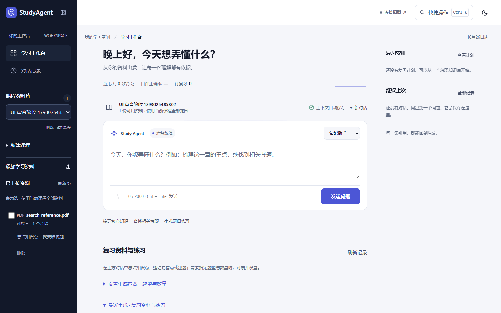
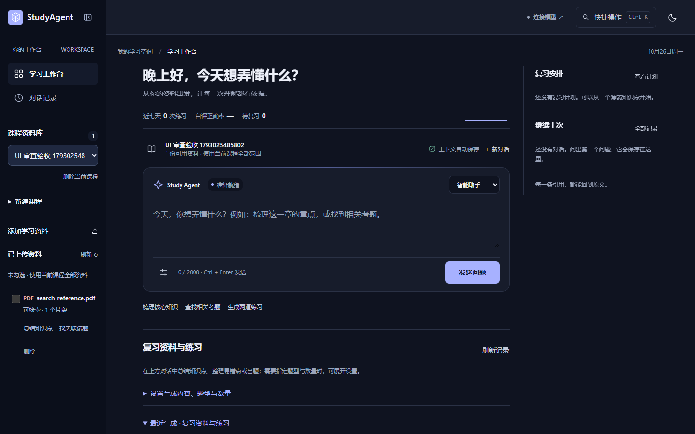
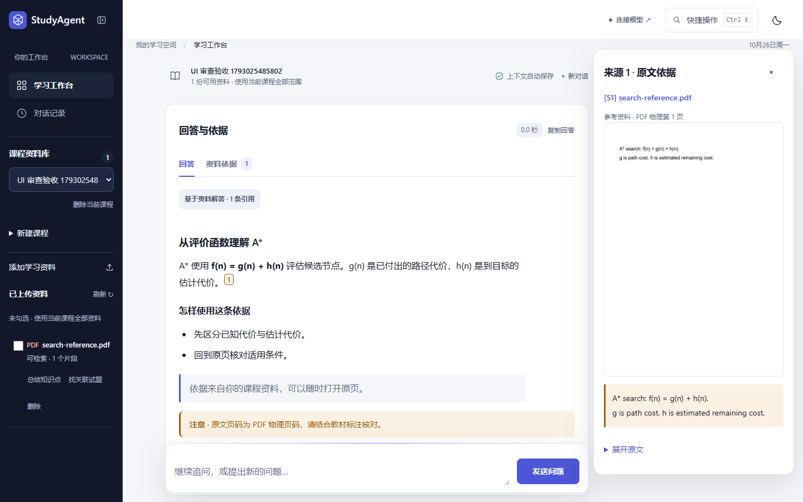

# 安静研读桌 · 改造记录

2026-10-26，按本目录审计建议修改现有原生前端及配套只读接口。保留原品牌、登录、真实 SSE、资料范围、停止操作和浅深主题。

## 已落地

- 首屏：登录后隐藏装饰图，24–28px 问候、真实学习脉搏、合并的课程/范围/自动保存/新对话条、96px 起的自适应输入框；三条文字建议，设置进入工具栏。
- 布局：桌面 220px 导航、最大 760px 主列与 280px 上下文；窄屏上下文移至下方；平板默认图标导航，可从课程按钮展开资料库；手机保留资料抽屉。
- 阅读：72ch 上限，16px/1.9 正文；回答完成后滚动、聚焦标题并进入阅读模式，追问栏吸底且在未聚焦时压缩。
- 依据：琥珀色上标引用、悬停摘录、桌面来源面板/窄屏模态抽屉、原文节选高亮、PDF 原页预览、带物理页码的原文件链接；关闭预览恢复引用焦点。
- 预览接口：`GET /api/documents/{id}/pages/{page}?width=600`，复用模型原页渲染路径与 PDFium 锁，限制尺寸、页码、文档类型、状态与存储路径；使用账号工作区、磁盘缓存、ETag，并在文档/课程删除时清理对应缓存。
- 数据：近七天练习、自评正确率和待复习均来自 `/progress`；右栏展示计划总进度、薄弱点和最近三条对话。无自评显示 —，练习零值显示 0。
- 历史：按上海日期分组，展示回答摘要、回答依据、引用数；支持查看并追问和摘要搜索，空分组自动隐藏。仍有效且资料范围匹配的历史会话可以恢复。
- 生成物：API 增加节数、题量、去重主题数与来源数；列表改成结果卡。Word/Markdown 集中到折叠导出菜单，生成物回答不再重复展示回答导出提示。
- 执行：SSE 工具事件展示为纵向时间线，前端测量步骤耗时；完成后折叠为带步数的执行过程。
- 样式：`app.css` 为唯一页面入口，`tokens.css` 为唯一根主题定义，命名 cascade layers 固定旧样式优先级；移除未加载的 `vibrant.css`、`interactions.js`。新增 `scripts/build_static_assets.py`，根据内容生成静态资源版本。

## 验证

- 全部 Python 回归：**288 passed**；包含新增的预览缓存、图片尺寸、无效页码/宽度、非法路径、非 PDF、账号隔离、删除清理与摘要计数测试。
- Ruff 与 JavaScript 语法检查通过，`git diff --check` 通过。
- `scripts/browser_ui_audit.cjs`：**30 个组合通过，0 JavaScript 错误**。覆盖浅深色，320/390/768/1024/1366/1440 宽度的登录首屏，以及游客、回答状态；确认首屏发送按钮可见、无横向溢出、引用预览、真实 PDF 图片、焦点返回、Word 下载和历史筛选。
- 真实浏览器样式检查：1440/768/390，**0 FAIL、1 WARN**。保留的提示为“较多文字低于 13px”：这些是 12px 的状态与元信息，符合审计中 ≥12px 的下限，回答正文保持 16px。
- 静态风格扫描对 `box-shadow: none`、关闭 backdrop-filter 及隐藏 eyebrow 的选择器也会提示；实测确认静态卡片无阴影，阴影仅保留给浮层、聚焦和吸底输入条。
- 测试服务使用独立 `.tmp-ui-desk` 数据目录，没有修改原有 `data/`。浏览器回答使用本地 demo API 加明确的富文本验收样例，不代表真实模型输出；没有调用外部模型。

## 截图

手机与历史页面另见 [手机首屏](after/workbench-mobile.png)、[手机阅读](after/answer-mobile.png)、[历史页](after/history.png)。

## 设计复核与后续

参考方向：`editorial-greeting`，seed `1855245592`，保留项目原配色与字体；具体布局以本次审计的“安静研读桌”为准，没有另换品牌或引入远程素材。真实资料、物理页码与会话来源是本产品的界面内容，不使用虚构学习数据。

已复核：提问框是首屏最大操作区；主列与来源面板边界清楚；零值和缺失数据有区别；桌面与手机均保留直接提问、返回资料、查看依据的路径；来源抽屉关闭后回到原引用。

本次尚未实现：真实知识关系地图、数据库持久化的页数/处理完成时间、PDF 图像坐标级文本框高亮、移动端全屏编辑器、golden-image 自动像素比对。当前预览提供原页图片与引用节选高亮；窄屏右侧上下文采用纵向排列，引用预览采用模态抽屉。

后续改动前端后运行 `python scripts/build_static_assets.py` 更新内容哈希；浏览器验收脚本仅对隔离测试服务运行，避免生成验收课程到实际学习空间。

## 2026-10-28 · 侧栏收缩修复

修复最终样式覆盖收起宽度的问题。品牌右侧的收缩图标现在可在 220px 完整侧栏与 96px 图标栏之间切换，顶栏和内容区同步调整，并保存选择供刷新后恢复。平板不再由另一套 CSS 状态强制覆盖按钮选择；课程按钮统一使用同一展开操作。手机继续使用独立抽屉。

`scripts/browser_sidebar.cjs` 实测 1440/1024/768/390：点击收起/展开、键盘 Enter/Space、刷新持久化、课程按钮重新展开、手机抽屉均通过，无 JavaScript 错误。原 30 组界面回归通过，样式检查 0 FAIL；未改动后端。
